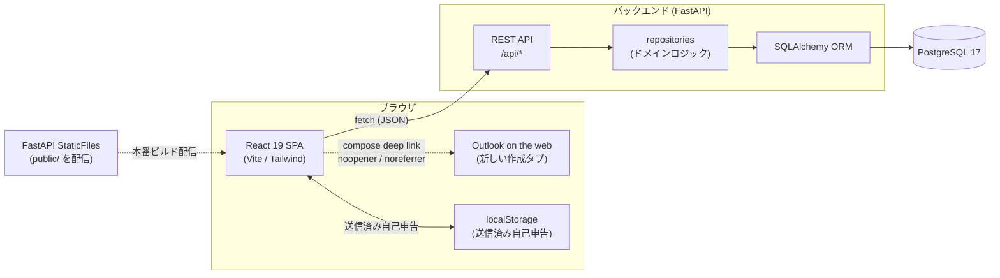
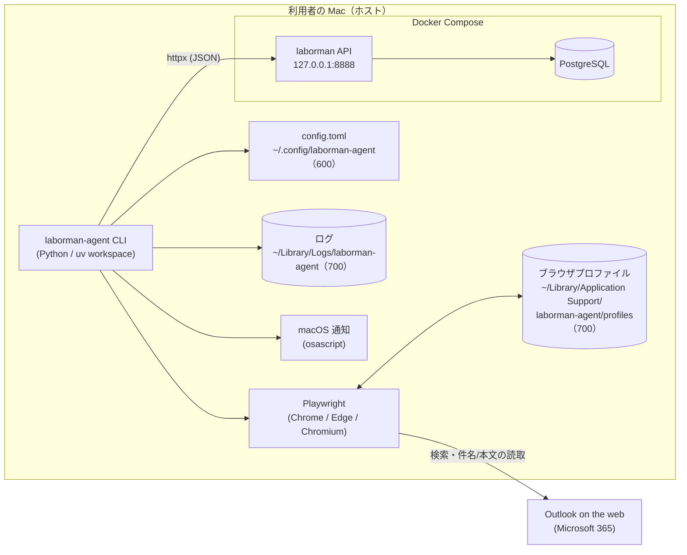
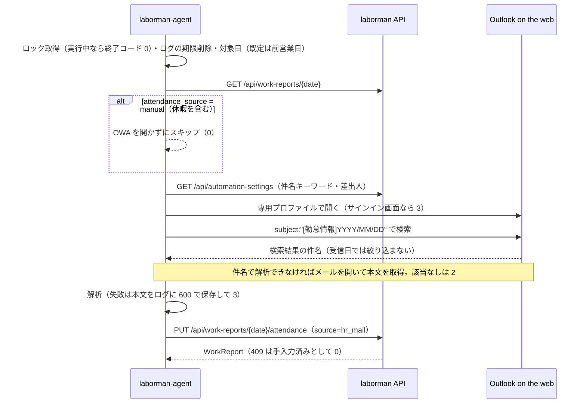
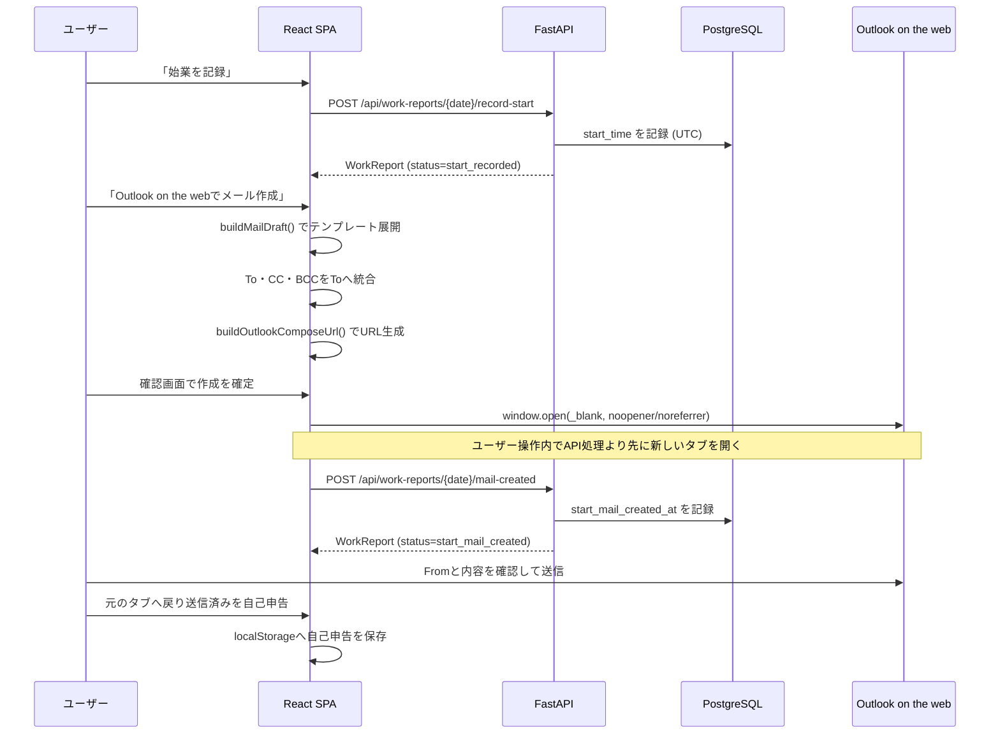
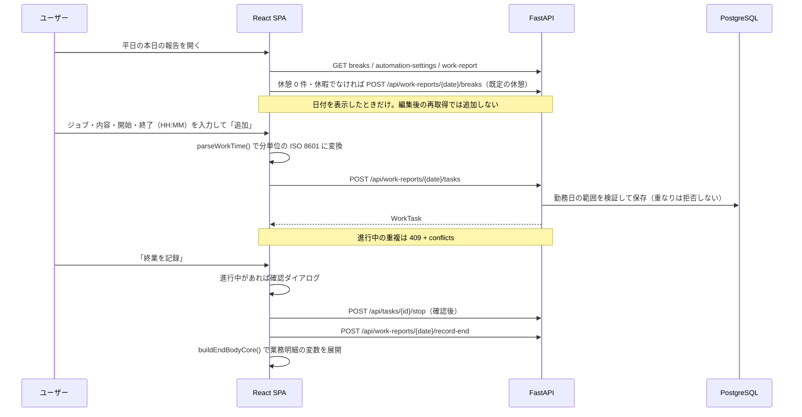
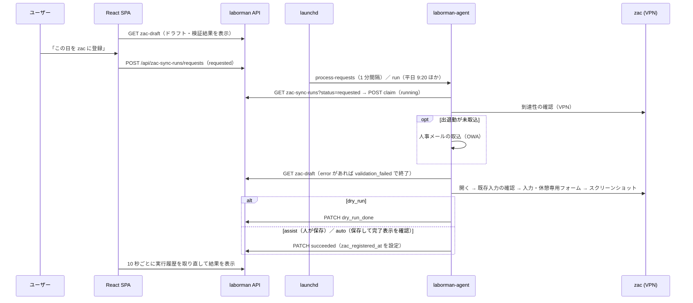

# ARCHITECTURE

laborman は **SPA フロントエンド + REST API バックエンド + PostgreSQL** の 3 層構成です。メール送信機能はサーバー側に持たず、フロントエンドがテンプレートから Outlook on the web の compose deep link を生成し、新しいブラウザタブの作成画面へ委譲します。

社内サインインが必要な外部画面（人事メールを読む Outlook on the web）の自動操作は、Docker の外の利用者の Mac で動くホスト側 CLI **laborman-agent**（`agent/`）が担当します。agent は laborman の HTTP API だけを使い、DB には直接接続しません。ブラウザ自動化（Playwright）は backend の依存・イメージに含めません。

## システム構成図

### laborman-agent の配置

| モジュール（`agent/laborman_agent/`） | 役割 |
|-----------|------|
| `cli.py` | `argparse` のエントリポイント（`login owa` / `fetch-attendance` / `doctor`）と終了コードの決定 |
| `config.py` | `config.toml` の読み込み、セレクタ・解析規則の既定値と上書き、権限の警告 |
| `api_client.py` | laborman API クライアント（httpx）。接続失敗は `ApiUnavailableError`（終了コード 1） |
| `business_days.py` | 前営業日の算出（土日・`jpholiday` の祝日を除く）と `--date` の解釈 |
| `lock.py` / `notify.py` / `logs.py` | `flock` による多重起動防止、macOS 通知、ログ（期限削除・調査用メールの `600` 保存） |
| `owa/fetch.py` | OWA の Page Object（サインイン画面の検知・検索・件名の取得・必要時のみ本文の取得） |
| `owa/parser.py` | 件名・本文から対象日の出退勤を抽出する純粋関数（NFKC 正規化、件名 → 本文の順に試行） |
| `attendance.py` | 人事メールの取込（`fetch-attendance` と `run` で共通。表示・通知は呼び出し側） |
| `runner.py` | zac 登録の一連の流れ（design D5）。状態ごとに実行履歴を記録し、終了コードと通知を決める |
| `zac/__init__.py` | zac の Page Object が提供する操作（`ZacReportPage`）、到達性（VPN）の確認、`login zac`、キーチェーンのパスワードでのサインイン |
| `zac/report_page.py` | zac の業務報告画面の Page Object（勤怠・休憩の時間数・作業登録・「保存」だけ）と、読み取り専用の `ZacMasterReader`（`sync-zac`） |
| `zac/credentials.py` | `security` コマンドでキーチェーンからパスワードを読む（ログ・例外に出さない） |
| `launchd/*.plist.example` | 平日朝の `run` と、1 分間隔の `process-requests` の launchd 設定例 |

## リクエストフロー（人事メールからの出退勤の取込）

## リクエストフロー（始業/終業メール作成）

## リクエストフロー（業務明細の入力・終業）

## リクエストフロー（zac 登録）

- **業務ルールは backend に集約** — クリップ・空き時間・入力行の集計・検証は `app/zac_draft.py` の純粋関数で算出し、画面とエージェントは同じ `GET zac-draft` の結果を使う。エージェントは「入力係」に徹する。
- **画面からの実行は依頼のキュー経由** — 画面（Docker 内から配信）はホストのコマンドを直接起動できないため、実行履歴に `requested` を記録し、エージェントが条件付き更新（`claim`）で取得したものだけを実行する。
- **誤登録の防止** — error のある日は保存しない、warning のある日は `auto` を `dry_run` に降格、zac の既存入力は上書きしない、保存完了の表示を確認できたときだけ `succeeded`、「申請」「承認依頼」は操作しない（Page Object に操作自体を持たせない）。

## レイヤー構成

### バックエンド（`backend/app/`）

| モジュール | 役割 |
|-----------|------|
| `main.py` | FastAPI アプリ生成、CORS ミドルウェア、ルーター登録、ドメイン例外（`ConflictError`→409 / `InvalidInputError`→422 / `NotFoundError`→404）のハンドラ、SPA 静的配信 |
| `routes.py` | プレゼンテーション層。`/api` 配下のエンドポイント定義と DTO シリアライズ |
| `repositories.py` | アプリケーション／ドメイン層。get-or-create、ステータス導出、勤務時間計算、ジョブ管理、タスク・休憩の検証（勤務日の範囲・進行中 1 件）と開始／停止、出退勤実績の登録（手入力の保護）、zac の実行履歴・依頼（`claim` の条件付き更新）・`zac_status` の導出 |
| `zac_draft.py` | zac 登録ドラフトの算出（純粋関数。出退勤 → 範囲内の休憩 → クリップ → 実働 → 空き時間 → 入力行〔作業内容 × 案件 × 売上項目ごと〕→ 検証） |
| `zac_months.py` | 案件名・売上項目名の年月表記（`（2026／10）`・`(26/10)`・`（2026年8月分）`）の読み取りとシリーズ名の導出 |
| `models.py` | インフラ層。SQLAlchemy ORM モデル（`MailSettings` / `WorkReport` / `Job` / `WorkTask` / `WorkBreak` / `AutomationSettings`） |
| `schemas.py` | Pydantic スキーマ（リクエスト／レスポンス DTO）とテンプレート初期値 |
| `database.py` | エンジン・セッションファクトリ・`get_db` 依存性 |
| `config.py` | `pydantic-settings` による環境変数読み込み（`lru_cache` でシングルトン化）。勤務日の境界判定に使う `app_timezone`（既定 `Asia/Tokyo`）を含む |
| `alembic/` | マイグレーション（モデルとは独立した DDL を保持） |

設計上のポイント:

- **ステータスは保存せず導出する** — `WorkReport` のタイムスタンプ列（`start_time`, `start_mail_created_at`, `end_time`, `end_mail_created_at`）から `derive_status()` が `ReportStatus` を算出します。状態の二重管理を避ける設計です。
- **get-or-create パターン** — 日付指定の参照・更新は対象行が無ければ自動生成（`get_or_create_report`）。フロントは「その日の報告が存在するか」を意識しなくてよい。
- **勤務時間は計算プロパティ** — `work_duration_minutes` はレスポンス時に `end_time - start_time` から算出（保存しない）。
- **時刻は UTC で保存** — 打刻は `datetime.now(UTC)` で記録し、表示整形はフロント側が担当。タスク・休憩の時刻はタイムゾーン付き ISO 8601 のみ受け付けます。
- **勤務日は 00:00〜翌 06:00** — `work_day_range()` が `app_timezone` 基準で勤務日の範囲を求め、範囲外の時刻を 422 で拒否します。日付をまたぐ作業は同じ勤務日のレコードとして扱います。
- **重なりは保存時に拒否しない** — タスク同士・タスクと休憩の時間帯が重なっても保存し、エラーも返しません（利用者が後で調整する。zac 登録前のドラフト検証で検出する）。進行中 1 件の制約は `ensure_single_running()` と部分ユニークインデックス（`uq_work_tasks_running` / `uq_work_breaks_running`）の二重で守ります。
- **開始は 1 トランザクション** — `start_task()` / `start_break()` は進行中のタスク・休憩をサーバーの現在時刻で終了してから新しいレコードを作成し、失敗時はまとめてロールバックします。
- **出退勤実績は打刻と別に持つ** — 人事の出退勤（`attendance_*`）は打刻（`start_time` / `end_time`）と別の列で、打刻 API は変更しません。`update_attendance()` は手入力（`manual`）の日に人事メール（`hr_mail`）の登録が来たら 409 で拒否し、手入力を優先します。
- **ジョブは削除しない** — 過去のタスクの参照を保つため、ジョブは `is_active` で無効化します。タスクで使うたびに `last_used_at` を更新し、一覧は最近使った順に返します。

### フロントエンド（`frontend/src/`）

| パス | 役割 |
|------|------|
| `App.tsx` | 画面状態管理（`today` / `calendar` / `settings` の 3 ビュー切替）と API オーケストレーション |
| `components/TodayReport.tsx` | 本日の打刻・メモ入力・メール作成ボタン、`{{tasks}}` の読み取り専用プレビュー（コピー可）、終業時の進行中タスク・休憩の確認 |
| `components/ZacTaskFields.tsx` | タスクの売上項目・作業内容の選択欄（売上項目はジョブの選択肢だけ） |
| `lib/zacDefaults.ts` | 月ごとの案件のまとめ（勤務日の年月で解決）と、売上項目・作業内容の初期値の決め方 |
| `components/ZacPanel.tsx` | zac 登録パネル。ドラフト（入力行・実働・休憩）、検証結果（`BREAK_MISSING` を強調）、最新の実行結果、「この日を zac に登録」（依頼・取り消し・10 秒ごとの更新） |
| `components/AttendancePanel.tsx` | 出退勤（人事メール）の表示（時刻・登録元・取込日時・未取込・休暇）と「手入力」ダイアログ（`HH:MM`・区分） |
| `components/WorkDetailsPanel.tsx` | 業務明細パネル。ジョブ・内容・開始・終了（`HH:MM`）を入力してタスクを追加（追加後は次の開始に今回の終了を引き継ぐ）、休憩の追加、行の編集・削除、409（進行中の重複など）の相手の表示、作業・休憩の合計 |
| `lib/defaultBreak.ts` | 勤務日を表示したとき、平日・休憩 0 件・休暇でなければ既定の休憩を追加する（`ensureDefaultBreak`。祝日は区別しない） |
| `components/JobCombobox.tsx` | ジョブ選択のコンボボックス。有効なジョブを最近使った順に表示し、コード・表示名でインクリメンタル検索、未登録のジョブ ID をその場で登録 |
| `components/ReportCalendar.tsx` | 月次カレンダー（react-day-picker）。報告の状態と zac 状態（zac済・要対応・zac未登録の過去平日の強調） |
| `components/SettingsPanel.tsx` | メール設定フォーム、ジョブマスタ（追加・編集・無効化・ジョブ ID の変更）、既定の休憩、人事メールの検索条件（件名キーワード・差出人）、zac 連携（実行モード・入力形式・許容値・空き時間の扱い・既定ジョブ・内容の最大長） |
| `components/MailComposeDialog.tsx` | メール下書きプレビュー、M365／From確認案内、Outlook on the web の新規タブ起動、項目別コピー |
| `components/ui/` | shadcn-ui 系の共通 UI 部品 |
| `lib/api.ts` | `fetch` ラッパー。全 API 呼び出しを集約し、非 2xx を `ApiError`（`status`・`conflicts`）に変換 |
| `lib/mail.ts` | テンプレート展開（`renderTemplate`）、業務明細の変数生成（`buildTasksText` など）、終業本文コア（`buildEndBodyCore`）と Outlook compose deep link 構築（`buildOutlookComposeUrl`） |
| `lib/date.ts` | 日付・時刻・勤務時間の整形。勤務日基準の `HH:MM`（24:00〜29:59 は翌日）と ISO 8601 の相互変換（`parseWorkTime` / `formatWorkTime`） |
| `types.ts` | バックエンド DTO に対応する TypeScript 型 |

設計上のポイント:

- **メール送信は行わない** — `lib/mail.ts` が Outlook on the web の compose deep link を組み立て、宛先・件名・本文は `encodeURIComponent` でエスケープ、複数宛先はリテラルのカンマで連結します。送信操作はユーザーに委譲します。
- **宛先区分をToへ統合する** — compose deep linkでCCが反映されない実機結果に合わせ、`getOutlookToRecipients()` が登録上のTo・CC・BCCをこの順で統合し、`to` パラメータだけを生成します。自動入力と引き換えにCC/BCCの区分は維持されず、BCCを含む全宛先が受信者全員に表示されるため、設定画面と確認画面で警告します。
- **新しいタブを先に開く** — 確認クリックの同期処理内で `window.open` を呼び、`noopener,noreferrer` で元タブへの参照を渡しません。その後にメール作成済み API を実行するため、ポップアップブロックを避けながら元の laborman タブと記録フローを維持します。
- **外部タブの結果を推測しない** — Outlook on the web の読込状態、From、送信完了はクロスオリジンのため検知しません。「メール作成済み」は API、送信済みの自己申告は localStorage と責務を分けます。
- **テンプレート変数** — `{{date}}` `{{start_time}}` `{{end_time}}` `{{work_duration}}` `{{work_style}}` `{{next_work_style}}` `{{note}}` と、業務明細由来の `{{tasks}}` `{{tasks_by_job}}` `{{breaks}}` `{{task_total}}`、出退勤実績の `{{attendance_start}}` `{{attendance_end}}` を `renderTemplate` が置換。業務明細の変数は終了済みのタスク・休憩だけを開始順に展開し（進行中は含めない）、該当が無ければ空文字になります。

  | 変数 | 形式 |
  |------|------|
  | `{{tasks}}` | `HH:MM-HH:MM [ジョブID] 内容`（1 行 1 件、翌日は 24:00〜） |
  | `{{tasks_by_job}}` | `ジョブID 表示名 H:MM`（ジョブごとの合計） |
  | `{{breaks}}` | `HH:MM-HH:MM` |
  | `{{task_total}}` | `N時間MM分`（タスク合計） |
  | `{{attendance_start}}` / `{{attendance_end}}` | `HH:MM`（勤務日基準）。未登録は「未取込」 |

- **業務報告は記録から生成する** — 自由記述の「業務報告」欄は廃止し、終業メール本文コアは `buildEndBodyCore()` がテンプレートと業務明細から生成します。メール作成時にそのスナップショットを `end_mail_body` として保存します。既定の終業本文テンプレートの末尾は `業務明細:\n{{tasks}}` ですが、保存済みの設定は書き換えません。
- **勤務日基準の時刻入力** — 手入力は `parseWorkTime()` で `HH:MM` を `Asia/Tokyo`（backend の `app_timezone` と同じ値）の ISO 8601 に変換し、表示は `formatWorkTime()` で勤務日基準に戻します。
- **送信確認は localStorage** — 「送信済み」のチェック状態はサーバーに持たず、`laborman.sentConfirmations` キーでブラウザに保持。

## 技術選定の理由（概要）

- **FastAPI + Pydantic**: 型安全な DTO とスキーマ駆動の OpenAPI 自動生成。
- **SQLAlchemy 2.0 + Alembic**: 型付き ORM とマイグレーションの分離。
- **Outlook on the web compose deep link**: OS の既定メールクライアントに依存せず、Microsoft Graph のアプリ登録・権限同意・トークン管理や SMTP 認証情報を追加せずに会社のブラウザメール運用へ組み込めるため。CC/BCCはdeep linkで安定して反映されないため、全宛先をToへ統合するトレードオフを採用しています。
- **Docker Compose**: db / backend / frontend を 1 コマンドで再現。

## デプロイ構成

`docker-compose.yml` に 2 サービス: `db`（PostgreSQL、ヘルスチェック付き）、`backend`（マイグレーション後に uvicorn 起動。フロントエンドの本番ビルドを `public/` から配信）。backend のポートは `127.0.0.1:8888` に限定し、LAN からは到達させません（出退勤実績を書き換えられる API のため）。laborman-agent はホストで `uv` から実行します。詳細は [SETUP_GUIDE.md](./SETUP_GUIDE.md) を参照。
