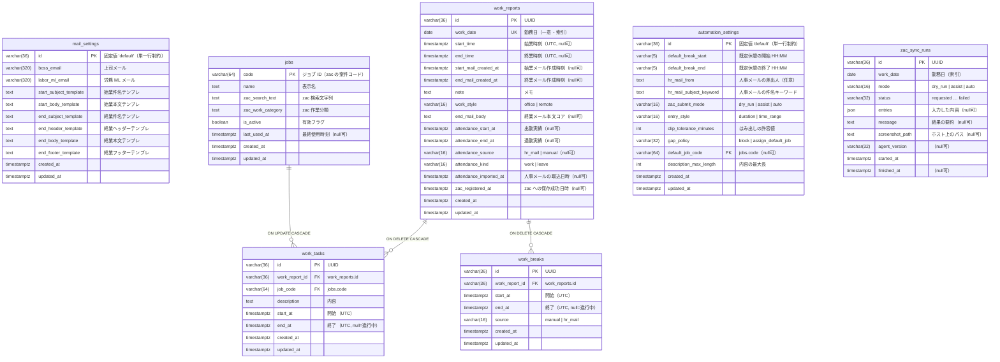

# DATABASE SCHEMA

- **DBMS**: PostgreSQL 17
- **ORM**: SQLAlchemy 2.0（モデル: `backend/app/models.py`）
- **マイグレーション**: Alembic（`backend/alembic/versions/`）

| リビジョン | 内容 |
|-----------|------|
| `20260606_0001` | `mail_settings` / `work_reports` を作成 |
| `20260611_0001` | `mail_settings` の `cc_emails` / `bcc_emails` を削除 |
| `20261012_0001` | `jobs` / `work_tasks` / `work_breaks` / `automation_settings` を作成（既存の `work_reports` / `mail_settings` の行は変更しない） |
| `20261013_0001` | `work_reports` に出退勤実績（`attendance_*`）、`automation_settings` に人事メールの検索条件（`hr_mail_*`）を追加（既存行は `attendance_kind = 'work'`、他は NULL / 空文字） |
| `20261013_0002` | `work_reports.zac_registered_at`、`automation_settings` の zac 連携の列、`zac_sync_runs` を追加 |
| `20261014_0001` | `zac_work_kinds`・`zac_sales_items` を作成し、`work_tasks.work_kind`・`sales_item_id`、`jobs.series_name`・`valid_month`、`automation_settings.default_work_kind`・`default_sales_item_id` を追加（既存のタスクは NULL のまま） |

`work_reports`（勤務日ごとの報告）に、タスク（`work_tasks`）と休憩（`work_breaks`）がぶら下がります。タスクはジョブマスタ（`jobs`）を参照します。`mail_settings` と `automation_settings` は単一行のグローバル設定で、他テーブルとのリレーションはありません。

## ER 図

## テーブル定義

### mail_settings（メール設定）

アプリ全体で 1 行のみ保持するグローバルなメール設定。`CHECK (id = 'default')` により単一行を強制。

| カラム | 型 | NULL | キー / 既定 | 説明 |
|--------|----|----|------|------|
| `id` | varchar(36) | NOT NULL | PK / `'default'` | 固定主キー |
| `boss_email` | varchar(320) | NOT NULL | `''` | 上司の宛先 |
| `labor_ml_email` | varchar(320) | NOT NULL | `''` | 労務メーリングリスト宛先 |
| `start_subject_template` | text | NOT NULL | — | 始業メール件名テンプレート |
| `start_body_template` | text | NOT NULL | — | 始業メール本文テンプレート |
| `end_subject_template` | text | NOT NULL | — | 終業メール件名テンプレート |
| `end_header_template` | text | NOT NULL | — | 終業メールヘッダー |
| `end_body_template` | text | NOT NULL | — | 終業メール本文コア（既定値の末尾は `業務明細:\n{{tasks}}`） |
| `end_footer_template` | text | NOT NULL | — | 終業メールフッター |
| `created_at` | timestamptz | NOT NULL | `now()` | 作成日時 |
| `updated_at` | timestamptz | NOT NULL | `now()` / onupdate | 更新日時 |

制約:

- `PRIMARY KEY (id)`
- `CHECK (id = 'default')` — `ck_mail_settings_single_row`（単一行を保証）

テンプレートで使用可能な変数: `{{date}}`, `{{start_time}}`, `{{end_time}}`, `{{work_duration}}`, `{{work_style}}`, `{{next_work_style}}`, `{{note}}`, `{{tasks}}`, `{{tasks_by_job}}`, `{{breaks}}`, `{{task_total}}`（展開はフロントエンドの `lib/mail.ts`）。既定の終業本文テンプレートに `{{tasks}}` を加えたのは新規作成時の既定値のみで、保存済みの設定行は書き換えません。

### work_reports（労務報告）

勤務日ごとに 1 レコード。打刻・メール作成のタイムスタンプを保持し、ステータスはこれらから導出する（DB には保存しない）。

| カラム | 型 | NULL | キー / 既定 | 説明 |
|--------|----|----|------|------|
| `id` | varchar(36) | NOT NULL | PK / UUID | 主キー（`uuid4()`） |
| `work_date` | date | NOT NULL | UNIQUE / index | 勤務日（日付単位で一意） |
| `start_time` | timestamptz | NULL | — | 始業打刻（UTC） |
| `end_time` | timestamptz | NULL | — | 終業打刻（UTC） |
| `start_mail_created_at` | timestamptz | NULL | — | 始業メール作成時刻 |
| `end_mail_created_at` | timestamptz | NULL | — | 終業メール作成時刻 |
| `note` | text | NOT NULL | `''` | メモ（アプリ側で最大 600 文字） |
| `work_style` | varchar(16) | NOT NULL | `'office'` | 勤務区分 |
| `end_mail_body` | text | NULL | — | 終業メール本文コア（作成時に `buildEndBodyCore()` の展開結果を保存。ヘッダー・フッターは含まない） |
| `attendance_start_at` | timestamptz | NULL | — | 出勤実績（人事の出退勤。打刻とは別） |
| `attendance_end_at` | timestamptz | NULL | — | 退勤実績 |
| `attendance_source` | varchar(16) | NULL | — | 登録元 `hr_mail`（laborman-agent）/ `manual`（UI の手入力）。未登録は NULL |
| `attendance_kind` | varchar(16) | NOT NULL | `'work'` | 区分 `work`（勤務）/ `leave`（休暇。手入力のみ） |
| `attendance_imported_at` | timestamptz | NULL | — | 人事メールから取り込んだ日時 |
| `zac_registered_at` | timestamptz | NULL | — | zac への保存成功日時（実行履歴が `succeeded` になったとき設定） |
| `created_at` | timestamptz | NOT NULL | `now()` | 作成日時 |
| `updated_at` | timestamptz | NOT NULL | `now()` / onupdate | 更新日時 |

制約・インデックス:

- `PRIMARY KEY (id)`
- `UNIQUE (work_date)` — `uq_work_reports_work_date`
- `CHECK (work_style IN ('office', 'remote'))` — `ck_work_reports_work_style`
- `CHECK (attendance_source IS NULL OR attendance_source IN ('hr_mail', 'manual'))` — `ck_work_reports_attendance_source`
- `CHECK (attendance_kind IN ('work', 'leave'))` — `ck_work_reports_attendance_kind`

人事メールの本文・件名・差出人の実データは保存しない（抽出した時刻・区分のみ）。
- `INDEX (work_date)` — `ix_work_reports_work_date`

### jobs（ジョブマスタ）

タスクに付けるジョブ ID と zac 対応情報。削除はせず、`is_active = false` で無効化する。

| カラム | 型 | NULL | キー / 既定 | 説明 |
|--------|----|----|------|------|
| `code` | varchar(64) | NOT NULL | PK | ジョブ ID（zac の案件コード） |
| `name` | text | NOT NULL | — | 表示名 |
| `zac_search_text` | text | NOT NULL | `''` | zac での検索文字列 |
| `zac_work_category` | text | NOT NULL | `''` | zac の作業分類 |
| `is_active` | boolean | NOT NULL | `true` | 有効フラグ（候補表示は有効分のみ） |
| `last_used_at` | timestamptz | NULL | — | タスクで最後に使った時刻（「最近使った順」の並びに使用） |
| `created_at` | timestamptz | NOT NULL | `now()` | 作成日時 |
| `updated_at` | timestamptz | NOT NULL | `now()` / onupdate | 更新日時 |

制約:

- `PRIMARY KEY (code)`

### work_tasks（タスク）

勤務日ごとのタスク。`end_at` が NULL のものは進行中。

| カラム | 型 | NULL | キー / 既定 | 説明 |
|--------|----|----|------|------|
| `id` | varchar(36) | NOT NULL | PK / UUID | 主キー（`uuid4()`） |
| `work_report_id` | varchar(36) | NOT NULL | FK / index | `work_reports.id` |
| `job_code` | varchar(64) | NOT NULL | FK | `jobs.code` |
| `description` | text | NOT NULL | `''` | 内容（アプリ側で最大 200 文字） |
| `start_at` | timestamptz | NOT NULL | — | 開始（UTC） |
| `end_at` | timestamptz | NULL | — | 終了（UTC、NULL = 進行中） |
| `created_at` | timestamptz | NOT NULL | `now()` | 作成日時 |
| `updated_at` | timestamptz | NOT NULL | `now()` / onupdate | 更新日時 |

制約・インデックス:

- `PRIMARY KEY (id)`
- `FOREIGN KEY (work_report_id) REFERENCES work_reports(id) ON DELETE CASCADE`
- `FOREIGN KEY (job_code) REFERENCES jobs(code) ON UPDATE CASCADE`
- `CHECK (end_at IS NULL OR end_at > start_at)` — `ck_work_tasks_end_after_start`
- `INDEX (work_report_id)` — `ix_work_tasks_work_report_id`
- `UNIQUE INDEX (work_report_id) WHERE end_at IS NULL` — `uq_work_tasks_running`（進行中は勤務日ごとに 1 件まで）

### work_breaks（休憩）

勤務日ごとの休憩。`end_at` が NULL のものは進行中。

| カラム | 型 | NULL | キー / 既定 | 説明 |
|--------|----|----|------|------|
| `id` | varchar(36) | NOT NULL | PK / UUID | 主キー（`uuid4()`） |
| `work_report_id` | varchar(36) | NOT NULL | FK / index | `work_reports.id` |
| `start_at` | timestamptz | NOT NULL | — | 開始（UTC） |
| `end_at` | timestamptz | NULL | — | 終了（UTC、NULL = 進行中） |
| `source` | varchar(16) | NOT NULL | `'manual'` | 登録元（`manual` = 画面操作、`hr_mail` = 出退勤取込用） |
| `created_at` | timestamptz | NOT NULL | `now()` | 作成日時 |
| `updated_at` | timestamptz | NOT NULL | `now()` / onupdate | 更新日時 |

制約・インデックス:

- `PRIMARY KEY (id)`
- `FOREIGN KEY (work_report_id) REFERENCES work_reports(id) ON DELETE CASCADE`
- `CHECK (end_at IS NULL OR end_at > start_at)` — `ck_work_breaks_end_after_start`
- `CHECK (source IN ('manual', 'hr_mail'))` — `ck_work_breaks_source`
- `INDEX (work_report_id)` — `ix_work_breaks_work_report_id`
- `UNIQUE INDEX (work_report_id) WHERE end_at IS NULL` — `uq_work_breaks_running`（進行中は勤務日ごとに 1 件まで）

時間帯の重なり（タスク同士・タスクと休憩）は DB 制約ではなく `repositories.check_overlaps()` が保存前に検証します（半開区間 `[start, end)`、進行中は現在時刻までとみなす）。

### automation_settings（自動化設定）

アプリ全体で 1 行のみ保持する自動化設定（既定の休憩・人事メールの検索条件）。`CHECK (id = 'default')` により単一行を強制。

| カラム | 型 | NULL | キー / 既定 | 説明 |
|--------|----|----|------|------|
| `id` | varchar(36) | NOT NULL | PK / `'default'` | 固定主キー |
| `default_break_start` | varchar(5) | NOT NULL | `'12:00'` | 既定休憩の開始（勤務日基準の HH:MM） |
| `default_break_end` | varchar(5) | NOT NULL | `'13:00'` | 既定休憩の終了（アプリ側で開始より後を検証） |
| `hr_mail_from` | text | NOT NULL | `''` | 人事メールの差出人（任意。空なら差出人で絞り込まない） |
| `hr_mail_subject_keyword` | text | NOT NULL | `''` | 人事メールの件名キーワード（実運用は `[勤怠情報]`。空なら取り込まない） |
| `zac_submit_mode` | varchar(16) | NOT NULL | `'dry_run'` | laborman-agent の実行モード（`dry_run`・`assist`・`auto`） |
| `entry_style` | varchar(16) | NOT NULL | `'duration'` | zac の入力形式（`duration`・`time_range`） |
| `clip_tolerance_minutes` | integer | NOT NULL | `15` | 出退勤からのはみ出しの許容値（分） |
| `gap_policy` | varchar(32) | NOT NULL | `'block'` | 空き時間の扱い（`block`・`assign_default_job`） |
| `default_job_code` | varchar(64) | NULL | FK → `jobs.code`（ON UPDATE CASCADE） | 空き時間の割当先 |
| `description_max_length` | integer | NOT NULL | `100` | zac の内容欄の最大長 |
| `created_at` | timestamptz | NOT NULL | `now()` | 作成日時 |
| `updated_at` | timestamptz | NOT NULL | `now()` / onupdate | 更新日時 |

制約:

- `PRIMARY KEY (id)`
- `CHECK (id = 'default')` — `ck_automation_settings_single_row`

### zac_work_kinds（zac の作業内容）

| カラム | 型 | NULL | キー / 既定 | 説明 |
|--------|----|----|------|------|
| `name` | varchar(100) | NOT NULL | PK | 作業内容（例：プロジェクト作業） |
| `is_active` | boolean | NOT NULL | `true` | 有効/無効 |
| `sort_order` | integer | NOT NULL | `0` | zac の選択肢の並び順 |
| `created_at` / `updated_at` | timestamptz | NOT NULL | `now()` | |

### zac_sales_items（zac の売上項目）

| カラム | 型 | NULL | キー / 既定 | 説明 |
|--------|----|----|------|------|
| `id` | varchar(36) | NOT NULL | PK / UUID | |
| `job_code` | varchar(64) | NOT NULL | FK → `jobs.code`（ON UPDATE CASCADE）・index | 案件 |
| `name` | text | NOT NULL | `UNIQUE (job_code, name)` | 売上項目名（zac の表示名） |
| `valid_month` | varchar(7) | NULL | — | 名前の年月表記から読み取った対象年月（`YYYY-MM`）。作業の種類を表す項目は NULL |
| `is_closed` | boolean | NOT NULL | `false` | zac で「売上計上済」 |
| `is_active` | boolean | NOT NULL | `true` | 有効/無効 |
| `sort_order` | integer | NOT NULL | `0` | 並び順 |
| `created_at` / `updated_at` | timestamptz | NOT NULL | `now()` | |

`work_tasks` には `work_kind`（FK → `zac_work_kinds.name`、ON UPDATE CASCADE、NULL 可）と `sales_item_id`（FK → `zac_sales_items.id`、NULL 可）、`jobs` には `series_name`（varchar(200)、NULL 可）と `valid_month`（varchar(7)、NULL 可）を追加。`jobs.zac_work_category` は「既定の作業内容」として使う。

### zac_sync_runs（zac 連携の実行履歴）

laborman-agent の実行結果と、画面からの実行依頼（`requested`）のキューを兼ねる。

| カラム | 型 | NULL | キー / 既定 | 説明 |
|--------|----|----|------|------|
| `id` | varchar(36) | NOT NULL | PK / UUID | 主キー |
| `work_date` | date | NOT NULL | index | 対象の勤務日 |
| `mode` | varchar(16) | NOT NULL | — | `dry_run`・`assist`・`auto` |
| `status` | varchar(32) | NOT NULL | — | `requested`・`cancelled`・`running`・`succeeded`・`dry_run_done`・`awaiting_user`・`validation_failed`・`needs_login`・`vpn_unreachable`・`hr_mail_not_found`・`already_registered_in_zac`・`failed` |
| `entries` | json | NULL | — | 入力した（しようとした）内容のスナップショット |
| `message` | text | NULL | — | 結果の要約（メール本文・画面の内容は入れない） |
| `screenshot_path` | text | NULL | — | ホスト上のスクリーンショットのパス（画像は DB に入れない） |
| `agent_version` | varchar(32) | NULL | — | エージェントのバージョン |
| `started_at` | timestamptz | NOT NULL | — | 開始日時（依頼は依頼日時、取得時に更新） |
| `finished_at` | timestamptz | NULL | — | 終了日時 |

制約: `CHECK (mode IN (…))` — `ck_zac_sync_runs_mode`、`CHECK (status IN (…))` — `ck_zac_sync_runs_status`、`INDEX (work_date)` — `ix_zac_sync_runs_work_date`

## 導出値（非永続）

API レスポンス時にコードで算出され、テーブルには列を持ちません（`backend/app/repositories.py`）:

- **`status`**: タイムスタンプ列から `derive_status()` で算出（`not_started` → `start_recorded` → `start_mail_created` → `end_recorded` → `end_mail_created`）。
- **`work_duration_minutes`**: `end_time - start_time` を分換算（いずれか未設定、または負値なら `null`）。
- **`zac_status`**: `zac_registered_at` があれば `registered`、なければ最新の実行履歴（取り消した依頼を除く）が `validation_failed`・`needs_login`・`failed`・`already_registered_in_zac` なら `needs_action`、それ以外は `null`。
