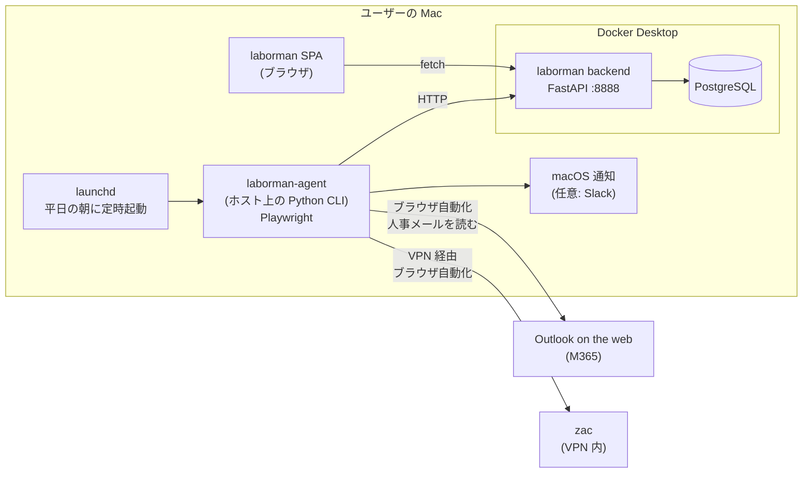
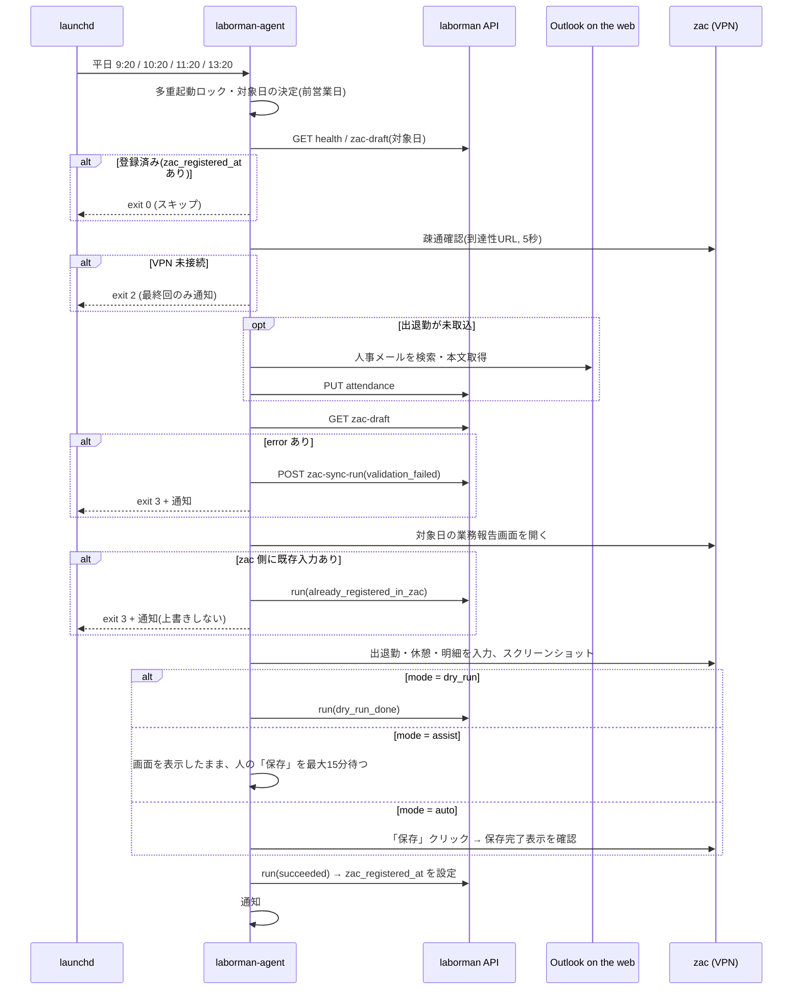
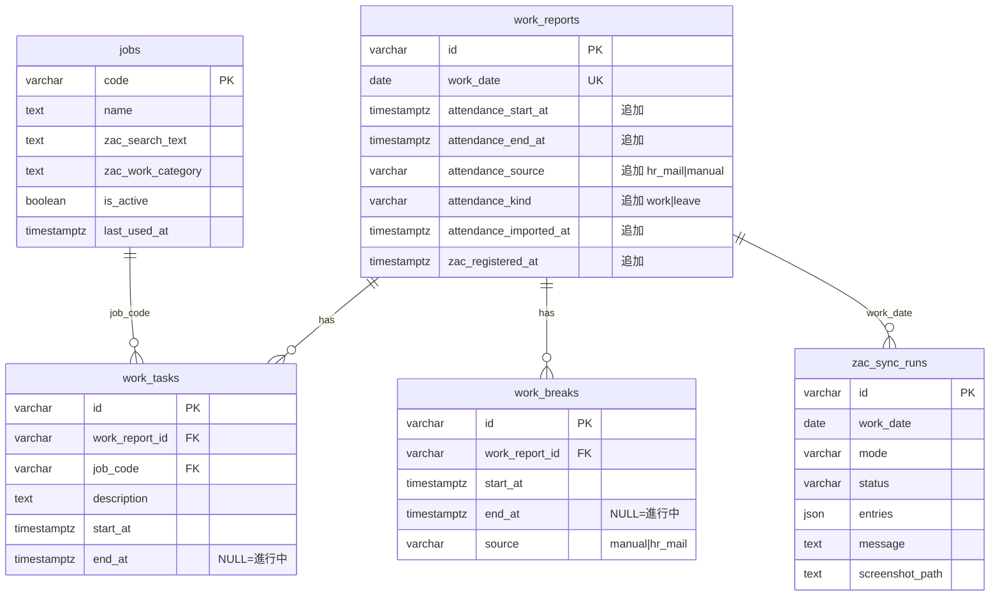

# laborman 改修仕様：業務明細のテーブル化と zac 業務報告の自動登録

| 項目 | 内容 |
|------|------|
| 文書ステータス | ドラフト v0.1（要確認事項あり → [§13](#13-要確認事項)） |
| 作成日 | 2026-10-12 |
| 基準コード | `origin/main` `472e097`（2026-10-05「曜日ごとに勤務区分の初期値と翌営業日の勤務区分を設定」） |
| 対象リポジトリ | `sudabon/laborman` |
| 想定する進め方 | 本書を入力に OpenSpec の change を 3 本に分けて提案・実装する（[§12](#12-実装フェーズと受け入れ基準)） |

> **注意**：Mac 上のローカルクローン（`/Users/suda/workspace/sudabon/laborman`）は `da9cb1e`（2026-06-06）で、`origin/main` より 8 コミット古い状態です。実装前に `git pull` してください。本書のファイルパス・API・テーブル定義は `origin/main` 基準です。

---

## 0. 背景と解決したい作業

毎朝、次の手作業を行っている。

1. 人事から届く**出退勤の履歴メール**（Microsoft 365 / Outlook on the web）を開き、前日の出勤・退勤時刻を確認する。
2. laborman の「業務報告」欄に**自由記述で書いたジョブ ID と作業時間**を確認する。
3. VPN 経由でしかアクセスできない社内 Web アプリ **zac** を開き、前日の**業務報告**に、出勤・退勤時刻と、ジョブごとの作業を画面操作で登録する。

本改修では、(a) タスクと休憩を**専用テーブル**に構造化して記録し、(b) 人事メールから出退勤実績を**自動取得**し、(c) zac への登録を**ブラウザ自動化**で行う。

## 1. ゴールと非ゴール

### ゴール

- G1：タスク（ジョブ ID・開始・終了・内容）と休憩（開始・終了）を、1 件ずつレコードとして記録・編集できる。
- G2：人事メールの出退勤実績を、手作業なしで laborman に取り込める。
- G3：zac に登録する内容（ドラフト）を laborman が算出し、登録前に画面で確認できる。
- G4：zac への登録を、`dry_run` → `assist` → `auto` の 3 段階で安全に自動化できる。
- G5：毎朝、Mac 上で定時に自動実行され、結果と要対応事項が通知される。

### 非ゴール（本改修では扱わない）

- zac の「申請・承認依頼」操作（**保存まで**を自動化の上限とする）
- Microsoft Graph API・SMTP・IMAP によるメール取得（管理者承認が得られない前提を維持）
- クラウド上のエージェント（Grok Bot 等）での実行（zac は VPN 内、DB はローカルのため）
- マルチユーザー対応・認証の追加（単一ユーザー・ローカル利用の前提を維持）
- 有給・休暇申請の自動化（休暇日は登録対象外としてスキップ）

## 2. 現状（As-Is）の整理

| 領域 | 現状（`origin/main`） |
|------|----------------------|
| 構成 | FastAPI（`backend/app/`）＋ PostgreSQL 17 ＋ React SPA（ビルド成果物を `backend/public/` から配信）。`docker-compose.yml` は `db` と `backend`（ポート `8888`） |
| テーブル | `mail_settings`（単一行）、`work_reports`（`work_date` で 1 日 1 行） |
| 業務内容 | `work_reports.end_mail_body` に**自由記述**（UI 上の「業務報告」テキストエリア）。ジョブ ID・時刻は構造化されていない |
| 打刻 | `start_time` / `end_time` はボタン押下時刻（UTC 保存）。**人事の出退勤実績とは別物** |
| 休憩 | 記録手段なし |
| テンプレート変数 | `{{date}}` `{{start_time}}` `{{end_time}}` `{{work_duration}}` `{{work_style}}` `{{next_work_style}}` `{{note}}`（展開は `frontend/src/lib/mail.ts`） |
| テスト | backend：pytest（SQLite インメモリ）、frontend：Vitest |
| 仕様管理 | OpenSpec（`openspec/specs/` に 4 capability） |

## 3. 全体アーキテクチャ（To-Be）



### 設計判断

| # | 判断 | 理由 |
|---|------|------|
| D1 | ブラウザ自動化は **ホスト（macOS）上の別プロセス `laborman-agent`** で行い、backend コンテナには入れない | VPN の経路はホスト側にある。サインイン切れ時に**画面付き（headed）ブラウザ**で人が介入する必要がある。セッション（Cookie）をホストのプロファイルに閉じ込められる |
| D2 | エージェントは DB に直接つながず、**laborman の HTTP API 経由**で読み書きする | 業務ルール（ドラフト算出・検証）を backend に一元化し、UI とエージェントで結果を一致させるため |
| D3 | zac 登録内容（ドラフト）は **backend が算出**し、エージェントはそれを画面に入力するだけにする | ブラウザ操作のコードを「入力係」に限定し、ロジックを pytest で検証できるようにするため |
| D4 | 段階的な実行モード `dry_run` / `assist` / `auto` を設ける | zac の業務報告は勤怠の公式記録を兼ねるため、誤登録のコストが高い |
| D5 | 秘密情報（パスワード・トークン）は DB・設定ファイルに保存しない | 既存方針（`work-report-logging` の「保存情報の範囲」）を踏襲。セッションは Playwright のプロファイル、zac の ID/PW が必要な場合は macOS キーチェーン |

---

## 4. 機能仕様

### 4.1 タスクの記録（capability: `work-task-logging`）

**REQ-T1**：システムは、勤務日ごとにタスク（ジョブ ID・内容・開始・終了）を複数件記録できなければならない（SHALL）。

**REQ-T2**：システムは「タスク開始」操作で、現在時刻を開始時刻とする**進行中タスク**（終了時刻なし）を作成しなければならない（SHALL）。進行中タスクがすでにある場合は、同じ時刻でそれを終了させてから新しいタスクを開始しなければならない（MUST）。

**REQ-T3**：同一勤務日に進行中のタスクは最大 1 件でなければならない（MUST）。

**REQ-T4**：システムは、同一勤務日内でタスク同士、およびタスクと休憩の時間帯が重なる保存を拒否しなければならない（MUST）。拒否時は重なっている相手のレコードを示す。

**REQ-T5**：過去日のタスクも、開始・終了時刻を手入力して追加・編集・削除できなければならない（SHALL）。

**REQ-T6**：時刻入力は勤務日を基準とした `HH:MM` 形式とし、`24:00`〜`29:59` は翌日の時刻として扱わなければならない（SHALL）。

シナリオ：

- **WHEN** 09:00 に JOB-A のタスクが進行中で、10:30 に JOB-B で「タスク開始」する **THEN** JOB-A は 10:30 で終了し、JOB-B が 10:30 開始の進行中タスクになる。
- **WHEN** 13:00–14:00 のタスクがある日に 13:30–15:00 のタスクを保存しようとする **THEN** `409 Conflict` を返し、重なっているタスクの ID と時間帯を示す。
- **WHEN** 終了時刻に `25:15` を入力する **THEN** 勤務日の翌日 01:15（Asia/Tokyo）として保存される。

### 4.2 休憩の記録（capability: `break-logging`）

**REQ-B1**：システムは、勤務日ごとに休憩（開始・終了）を複数件記録できなければならない（SHALL）。

**REQ-B2**：「休憩開始」操作では、進行中タスクを同じ時刻で終了させ、進行中の休憩を作成しなければならない（SHALL）。

**REQ-B3**：「休憩終了」操作では、進行中の休憩を終了させなければならない（SHALL）。あわせて、直前に終了したタスクと同じジョブ・内容でタスクを再開するボタン（「再開」）を表示する。

**REQ-B4**：設定で**既定の休憩**（例：12:00–13:00）を定義できなければならない（SHALL）。勤務日にタスクが 1 件以上あり、休憩が 0 件のまま zac ドラフトを算出する場合は、既定の休憩を**提案**として表示する（自動で保存はしない）。

### 4.3 ジョブマスタ（capability: `job-master`）

**REQ-J1**：システムは、ジョブ ID（= zac の案件コード）と表示名、zac 上で案件を選ぶための検索文字列・作業分類を保持するジョブマスタを提供しなければならない（SHALL）。

**REQ-J2**：タスク入力時のジョブ選択は、最近使ったジョブ順の候補とインクリメンタル検索で行えなければならない（SHALL）。未登録のジョブ ID を入力した場合は、その場で登録できるようにする。

**REQ-J3**：無効化（`is_active = false`）されたジョブは新規タスクの候補に出さないが、既存タスクの表示には影響させてはならない（MUST NOT）。

### 4.4 終業メール本文の生成変更（capability: `outlook-mail-compose` の変更）

**REQ-M1**：テンプレート変数に以下を追加しなければならない（SHALL）。

| 変数 | 展開例 |
|------|--------|
| `{{tasks}}` | `09:00-10:30 [JOB-A] 設計レビュー` を 1 行ずつ、開始時刻順 |
| `{{tasks_by_job}}` | `JOB-A 案件名 3:15` をジョブごとに集計 |
| `{{breaks}}` | `12:00-13:00` を 1 行ずつ |
| `{{task_total}}` | `7時間45分`（タスク合計） |
| `{{attendance_start}}` / `{{attendance_end}}` | 人事メール由来の出勤・退勤時刻（未取込なら「未取込」） |

**REQ-M2**：「本日の報告」画面の自由記述「業務報告」テキストエリアは廃止し、タスク一覧から生成した `{{tasks}}` のプレビュー（読み取り専用・コピー可）に置き換えなければならない（SHALL）。補足の文章は既存の「メモ」を使う。

**REQ-M3**：既存の `mail_settings` 行のテンプレートはマイグレーションで書き換えてはならない（MUST NOT）。既定テンプレート（`DEFAULT_END_BODY_TEMPLATE`）にのみ `{{tasks}}` を追加し、設定画面に「`{{tasks}}` を追加すると業務明細が本文に入ります」という案内を表示する。

**REQ-M4**：`work_reports.end_mail_body` は「作成したメール本文コアのスナップショット」として従来どおり保存する（既存 API `PATCH .../work-reports/{date}` の `end_mail_body` も互換のため残す）。

### 4.5 出退勤実績の取込（capability: `attendance-import`）

**REQ-A1**：システムは、勤務日ごとに**出勤・退勤の実績時刻**（人事メール由来）を、既存の打刻（`start_time` / `end_time`）とは別の項目として保持しなければならない（SHALL）。

**REQ-A2**：エージェントは、Outlook on the web をブラウザ自動化で開き、設定した検索条件（差出人・件名キーワード・受信日）に一致する当日受信の人事メールを探し、本文から対象日の出勤・退勤時刻（含まれていれば休憩）を抽出して API に登録しなければならない（SHALL）。

人事メールに休憩が**時間帯**で書かれている場合は `work_breaks`（`source = 'hr_mail'`）として登録する（手入力の休憩と重なる場合は登録せず警告）。**分数のみ**の場合は保存せず、ドラフト検証で手入力の休憩合計と比較して、差があれば warning `BREAK_MISMATCH` とする。

**REQ-A3**：人事メールが見つからない場合、エージェントは「後で再試行」を示す終了コード（`2`）で終了し、DB を変更してはならない（MUST NOT）。

**REQ-A4**：本文の解析に失敗した場合、エージェントは失敗を記録・通知し、メール本文を DB に保存してはならない（MUST NOT）。デバッグ用の本文はローカルのログディレクトリ（権限 `600`）にのみ保存し、14 日で削除する。

**REQ-A5**：UI から出退勤実績を手入力・上書きできなければならない（SHALL）。手入力した値は `attendance_source = 'manual'` とし、エージェントは `manual` の値を上書きしてはならない（MUST NOT）。

**REQ-A6**：人事メールに対象日の「休暇」等の表記がある場合、その日は `attendance_kind = 'leave'` として記録し、zac 登録の対象外にする（表記は §13 で確定）。

### 4.6 zac 登録ドラフトの算出（capability: `zac-draft`）

backend が勤務日ごとに「zac に入力する内容」と「検証結果」を算出する。エージェントも UI も同じ API（`GET /api/work-reports/{date}/zac-draft`）を使う。

#### 算出手順

1. **出退勤**：`attendance_start_at` / `attendance_end_at` を使う（laborman の打刻時刻は使わない）。
2. **休憩**：`work_breaks` のうち出退勤の範囲内のもの。
3. **タスクのクリップ**：出退勤の範囲からはみ出したタスクは、はみ出しが許容値（既定 15 分）以内なら範囲内に切り詰めて警告、超えたらエラー。
4. **実働時間** `W = 退勤 − 出勤 − 休憩合計`。
5. **空き時間（どのタスクにも休憩にも含まれない時間）**の扱いは設定 `gap_policy` に従う。
   - `block`（既定）：エラー `UNCOVERED_TIME`
   - `assign_default_job`：設定した既定ジョブ（例：社内業務）に割り当て、警告
6. **入力行の生成**（設定 `entry_style` に従う。zac の画面仕様が確定したら片方に固定してよい）
   - `duration`：ジョブごとに時間を集計し、`time_unit_minutes`（既定 15 分）単位に丸める。**丸め後の合計が `W` を単位で切り捨てた値と一致する**よう、最大剰余法で配分する。内容は同じジョブの内容を開始順に「、」で連結し、`description_max_length` で切り詰める。
   - `time_range`：タスクを時刻順のまま 1 行ずつ出力する（連続する同一ジョブ・同一内容は結合）。
7. **検証**（下表）。`error` が 1 件でもあれば登録不可、`warning` があれば `auto` は不可（`dry_run` に降格して通知）。

| コード | 重要度 | 条件 |
|--------|--------|------|
| `ATTENDANCE_MISSING` | error | 出退勤実績が未取込 |
| `ON_LEAVE` | error | 休暇日（登録対象外） |
| `NO_TASKS` | error | タスクが 0 件 |
| `TASK_RUNNING` | error | 終了時刻のないタスク・休憩がある |
| `TASK_OVERLAP` | error | タスク同士・タスクと休憩が重なる（API で防ぐが、念のため再検証） |
| `TASK_OUTSIDE_ATTENDANCE` | error / warning | 出退勤の範囲外（許容値以内なら warning ＋クリップ） |
| `UNCOVERED_TIME` | error / warning | 空き時間あり（`gap_policy` による） |
| `JOB_UNKNOWN` | error | ジョブマスタに存在しない、または zac 検索文字列が未設定 |
| `TOTAL_MISMATCH` | error | 丸め後の合計と実働時間が一致しない（配分ロジックの不具合検知用） |
| `BREAK_SUGGESTED` | warning | 休憩 0 件で既定休憩を提案中 |
| `BREAK_MISMATCH` | warning | 人事メールの休憩分数と手入力の休憩合計が異なる |
| `ALREADY_REGISTERED` | info | `zac_registered_at` が設定済み |

#### レスポンス例

```jsonc
// GET /api/work-reports/2026-10-09/zac-draft
{
  "work_date": "2026-10-09",
  "attendance": { "start": "09:02", "end": "18:41", "source": "hr_mail" },
  "breaks": [{ "start": "12:00", "end": "13:00" }],
  "working_minutes": 519,
  "entry_style": "duration",
  "entries": [
    { "job_code": "JOB-A", "zac_search_text": "A社 保守", "work_category": "開発",
      "minutes": 300, "description": "設計レビュー、障害調査" },
    { "job_code": "JOB-B", "zac_search_text": "社内業務", "work_category": "社内",
      "minutes": 210, "description": "定例MTG、資料作成" }
  ],
  "issues": [
    { "code": "TASK_OUTSIDE_ATTENDANCE", "severity": "warning",
      "message": "09:00開始のタスクを出勤時刻09:02に切り詰めました", "ref_id": "…" }
  ],
  "registrable": true,        // error が 0 件
  "auto_allowed": false,      // warning が 1 件以上
  "zac_registered_at": null
}
```

配分の計算例：クリップ後の JOB-A = 88 + 210 = 298 分、JOB-B = 90 + 131 = 221 分（合計 519 分 = `W`）。目標合計は 519 を 15 分単位で切り捨てた 510 分。各ジョブを切り捨てると 285 + 210 = 495 分で 15 分不足するため、剰余の大きい JOB-A（13 分）に 15 分を足し、JOB-A 300 分・JOB-B 210 分とする。

### 4.7 zac 自動登録エージェント（capability: `zac-registration`）

#### 実行フロー（`laborman-agent run`）



#### 要件

**REQ-Z1**：対象日は既定で「実行日の前営業日」（土日・祝日〔`jpholiday`〕を除く）とし、`--date` で指定できなければならない（SHALL）。

**REQ-Z2**：実行モードは `dry_run` / `assist` / `auto` とし、既定値は設定 `zac_submit_mode` から取得、`--mode` で上書きできなければならない（SHALL）。初期値は `dry_run` とする。

**REQ-Z3**：ドラフトに `error` がある場合、どのモードでも zac の「保存」を実行してはならない（MUST NOT）。`warning` がある場合、`auto` は `dry_run` として動作し、その旨を通知する。

**REQ-Z4**：zac の対象日に既存の入力がある場合、上書きしてはならない（MUST NOT）。状態 `already_registered_in_zac` を記録して通知する。

**REQ-Z5**：zac の「申請」「承認依頼」等の操作を行ってはならない（MUST NOT）。自動化の上限は「保存」とする。

**REQ-Z6**：保存後は、保存完了の表示を確認できた場合にのみ `succeeded` を記録しなければならない（MUST）。確認できない場合は `failed` とし、スクリーンショットのパスを記録する。

**REQ-Z7**：サインイン切れ（OWA・zac とも）を検知した場合、`needs_login` を記録して通知し、`laborman-agent login owa|zac` で画面付きブラウザを開いて手動サインインできるようにしなければならない（SHALL）。パスワードの入力・保存は行わない。

**REQ-Z8**：同時に 2 つの `run` が動いてはならない（MUST NOT）。ロックファイルで排他する。

**REQ-Z9**：すべての実行結果を `zac_sync_runs` に記録しなければならない（SHALL）。

#### 実行モードの段階的な切り替え（運用ルール）

| 段階 | モード | 期間の目安 | 切り替え条件 |
|------|--------|-----------|-------------|
| 1 | `dry_run` | 2 週間 | 毎日のスクリーンショットと zac の手入力結果が一致 |
| 2 | `assist` | 2 週間 | 入力内容を人が修正せずに保存できた日が 10 営業日連続 |
| 3 | `auto` | — | 以降も `warning` のある日は自動で `dry_run` に降格 |

### 4.8 画面（UI）の変更

#### 本日の報告（`TodayReport.tsx`）

カレンダーから過去日（10/9）を開いた例。§4.6 のレスポンス例と同じデータ。

```
┌─ 報告 2026年10月9日(金) ───────────────────── [状態: 終業メール作成済み] ─┐
│ 出退勤(人事メール)  09:02 – 18:41   取込: 10/12 09:20  [手入力]          │
│ 打刻(laborman)      09:05 – 18:35                                        │
├─ 業務明細 ───────────────────────────────────────────────────────────┤
│ [ジョブ ▼ JOB-A A社保守][内容: 設計レビュー     ] [▶ タスク開始]          │
│ [☕ 休憩開始]  [■ 停止]  [既定の休憩を追加]                               │
│                                                                           │
│  開始   終了   ジョブ   内容            時間                              │
│  09:00  10:30  JOB-A    設計レビュー     1:30   ✎ 🗑                      │
│  10:30  12:00  JOB-B    定例MTG          1:30   ✎ 🗑                      │
│  12:00  13:00  (休憩)                    1:00   ✎ 🗑                      │
│  13:00  16:30  JOB-A    障害調査         3:30   ✎ 🗑                      │
│  16:30  18:41  JOB-B    資料作成         2:11   ✎ 🗑                      │
│  [+ 行を追加]                                                            │
│  合計 作業 8:41 / 休憩 1:00                                              │
├─ zac 登録 ────────────────────────────────────────────────────────────┤
│  ドラフト: JOB-A 5:00 / JOB-B 3:30（実働 8:39 → 15分単位 8:30）           │
│  ⚠ 1件: 09:00開始のタスクを出勤09:02に切り詰め  [詳細]                    │
│  最終実行: 10/12 09:21 dry_run_done  📷 スクリーンショット                 │
└───────────────────────────────────────────────────────────────────────────┘
```

- 当日の画面では、進行中のタスクに「■」（停止）を表示し、出退勤（人事メール）は翌朝の取込まで「未取込」と表示する。
- 「業務報告」テキストエリアは削除し、`{{tasks}}` プレビューを「メール作成」パネル内に表示（REQ-M2）。
- 進行中タスク・休憩がある場合、「終業を記録」ボタンの押下時に「進行中のタスクを終業時刻で終了しますか？」と確認する。
- ジョブ選択はコンボボックス（最近使った順＋検索）。

#### カレンダー（`ReportCalendar.tsx`）

- 各日に zac 状態を表示：`zac済`（`zac_registered_at` あり）／`要対応`（最新 run が `validation_failed`・`needs_login`・`failed`・`already_registered_in_zac`）／無印。
- 既存の「未報告の過去平日を強調」に加え、**zac 未登録の過去営業日**も強調する。

#### 設定（`SettingsPanel.tsx`）

- 新セクション「業務明細・zac」：ジョブマスタ管理、既定休憩、`time_unit_minutes`、`gap_policy`・既定ジョブ、`entry_style`、`zac_submit_mode`、人事メールの検索条件（差出人・件名キーワード）。

---

## 5. データモデル

Alembic マイグレーション `backend/alembic/versions/2026MMDD_0001_add_work_tasks_breaks_jobs.py` ほかで追加する。時刻はすべて `timestamptz`。



### 5.1 `work_tasks`（新規）

| カラム | 型 | NULL | 既定・制約 | 説明 |
|--------|----|----|-----------|------|
| `id` | varchar(36) | NOT NULL | PK, UUID | |
| `work_report_id` | varchar(36) | NOT NULL | FK → `work_reports.id` ON DELETE CASCADE, index | 勤務日 |
| `job_code` | varchar(64) | NOT NULL | FK → `jobs.code` ON UPDATE CASCADE | ジョブ ID |
| `description` | text | NOT NULL | `''` | 作業内容（最大 200 文字、アプリ側で検証） |
| `start_at` | timestamptz | NOT NULL | | 開始 |
| `end_at` | timestamptz | NULL | `CHECK (end_at IS NULL OR end_at > start_at)` | 終了（NULL は進行中） |
| `created_at` / `updated_at` | timestamptz | NOT NULL | `now()` | |

- 部分一意インデックス `uq_work_tasks_running`：`(work_report_id) WHERE end_at IS NULL`（REQ-T3）。SQLAlchemy では `Index(..., unique=True, postgresql_where=..., sqlite_where=...)` とし、SQLite のテストでも有効にする。
- 重なり検査（REQ-T4）はアプリ層（`repositories.py`）で行う（SQLite テストとの互換のため、PostgreSQL の排他制約は使わない）。
- SQLite は既定で外部キーの `ON DELETE CASCADE` が効かないため、ORM の relationship にも `cascade="all, delete-orphan"` を設定する。

### 5.2 `work_breaks`（新規）

`work_tasks` から `job_code`・`description` を除き、`source varchar(16) NOT NULL DEFAULT 'manual'`（`manual` | `hr_mail`）を加えたもの。部分一意インデックス `uq_work_breaks_running` も同様。

### 5.3 `jobs`（新規）

| カラム | 型 | NULL | 既定 | 説明 |
|--------|----|----|------|------|
| `code` | varchar(64) | NOT NULL | PK | ジョブ ID（zac の案件コード） |
| `name` | text | NOT NULL | | 表示名 |
| `zac_search_text` | text | NOT NULL | `''` | zac で案件を選ぶときの検索文字列（空なら `code`） |
| `zac_work_category` | text | NOT NULL | `''` | zac の作業分類（要確認） |
| `is_active` | boolean | NOT NULL | `true` | |
| `last_used_at` | timestamptz | NULL | | 候補の並び順に使用 |
| `created_at` / `updated_at` | timestamptz | NOT NULL | `now()` | |

### 5.4 `work_reports`（列追加）

| カラム | 型 | NULL | 説明 |
|--------|----|----|------|
| `attendance_start_at` | timestamptz | NULL | 出勤実績 |
| `attendance_end_at` | timestamptz | NULL | 退勤実績 |
| `attendance_source` | varchar(16) | NULL | `hr_mail` / `manual`（CHECK 制約） |
| `attendance_kind` | varchar(16) | NOT NULL, 既定 `'work'` | `work` / `leave`（CHECK 制約） |
| `attendance_imported_at` | timestamptz | NULL | 取込日時 |
| `zac_registered_at` | timestamptz | NULL | zac への保存成功日時 |

### 5.5 `zac_sync_runs`（新規）

| カラム | 型 | NULL | 説明 |
|--------|----|----|------|
| `id` | varchar(36) | NOT NULL | PK |
| `work_date` | date | NOT NULL | index |
| `mode` | varchar(16) | NOT NULL | `dry_run` / `assist` / `auto` |
| `status` | varchar(32) | NOT NULL | `running` / `succeeded` / `dry_run_done` / `awaiting_user` / `validation_failed` / `needs_login` / `vpn_unreachable` / `hr_mail_not_found` / `already_registered_in_zac` / `failed` |
| `entries` | json | NULL | 入力した（しようとした）内容のスナップショット |
| `message` | text | NULL | エラー・警告の要約 |
| `screenshot_path` | text | NULL | ホスト上のスクリーンショットのパス |
| `agent_version` | varchar(32) | NULL | |
| `started_at` / `finished_at` | timestamptz | NOT NULL / NULL | |

`json` 型は SQLAlchemy の `sa.JSON` を使う（PostgreSQL では `json`、テストの SQLite でも動作）。

### 5.6 `automation_settings`（新規・単一行）

`mail_settings` と同じく `CHECK (id = 'default')` の単一行テーブル。

| カラム | 型 | 既定 | 説明 |
|--------|----|------|------|
| `zac_submit_mode` | varchar(16) | `'dry_run'` | REQ-Z2 |
| `entry_style` | varchar(16) | `'duration'` | `duration` / `time_range` |
| `time_unit_minutes` | int | `15` | 丸め単位 |
| `clip_tolerance_minutes` | int | `15` | はみ出しの許容値 |
| `gap_policy` | varchar(32) | `'block'` | `block` / `assign_default_job` |
| `default_job_code` | varchar(64) NULL | NULL | 空き時間の割当先（FK → `jobs.code`） |
| `default_break_start` / `default_break_end` | varchar(5) | `'12:00'` / `'13:00'` | 既定休憩 |
| `description_max_length` | int | `100` | zac の内容欄の最大長（要確認） |
| `hr_mail_from` | text | `''` | 人事メールの差出人 |
| `hr_mail_subject_keyword` | text | `''` | 件名キーワード |

### 5.7 既存データの扱い

- 既存の `work_reports` 行はそのまま残す。新しい列は NULL（`attendance_kind` は `'work'`）。
- 過去の自由記述（`end_mail_body`）からタスクを起こす**任意の**移行スクリプト `backend/scripts/import_legacy_tasks.py` を用意する（§10）。

---

## 6. API 仕様（追加・変更）

既存の規約（プレフィックス `/api`、`{work_date}` は `YYYY-MM-DD`、存在しない日の報告は get-or-create）に従う。時刻は API では ISO 8601（タイムゾーン付き）でやり取りし、`HH:MM`（24:00〜29:59 を含む）との変換はフロントエンドで行う。

| メソッド | パス | 説明 |
|---------|------|------|
| GET | `/api/work-reports/{date}/tasks` | タスク一覧（開始順） |
| POST | `/api/work-reports/{date}/tasks` | タスク追加（`job_code`, `description`, `start_at`, `end_at?`） |
| PATCH | `/api/tasks/{id}` | タスク更新 |
| DELETE | `/api/tasks/{id}` | タスク削除 |
| POST | `/api/work-reports/{date}/tasks/start` | 現在時刻で開始（進行中タスクがあれば終了してから）（REQ-T2） |
| POST | `/api/tasks/{id}/stop` | 現在時刻で終了 |
| GET / POST | `/api/work-reports/{date}/breaks` | 休憩一覧・追加 |
| PATCH / DELETE | `/api/breaks/{id}` | 休憩更新・削除 |
| POST | `/api/work-reports/{date}/breaks/start` | 休憩開始（進行中タスクを終了）（REQ-B2） |
| POST | `/api/breaks/{id}/stop` | 休憩終了 |
| GET / POST | `/api/jobs` | ジョブ一覧（`?active=true&q=`）・追加 |
| PATCH | `/api/jobs/{code}` | ジョブ更新・無効化 |
| PUT | `/api/work-reports/{date}/attendance` | 出退勤実績の登録（`start_at`, `end_at`, `source`, `kind`）。`source=hr_mail` で既存値が `manual` の場合は `409`（REQ-A5） |
| GET | `/api/work-reports/{date}/zac-draft` | ドラフトと検証結果（§4.6） |
| GET | `/api/zac-sync-runs?work_date=` | 実行履歴 |
| POST | `/api/zac-sync-runs` | 実行開始の記録（`status=running`） |
| PATCH | `/api/zac-sync-runs/{id}` | 結果の記録。`status=succeeded` のとき対象日の `zac_registered_at` を設定 |
| GET / PUT | `/api/automation-settings` | §5.6 |

- `WorkReportRead` に `attendance_*`・`zac_registered_at`・`zac_status`（最新 run から導出）を追加する。
- エラー：重なりは `409`（`detail.conflicts` に相手の ID と時間帯）、検証失敗は `422`。
- `GET /api/work-reports?year=&month=` の応答に、カレンダー表示用の `zac_status` を含める（N+1 を避けるため、最新 run は 1 クエリで取得）。

---

## 7. laborman-agent（ホスト側 CLI）

### 7.1 配置と依存

```
agent/
├── pyproject.toml          # uv workspace member（ルート pyproject の members に追加）
├── laborman_agent/
│   ├── cli.py              # argparse エントリポイント
│   ├── config.py           # ~/.config/laborman-agent/config.toml を読む
│   ├── api_client.py       # laborman API クライアント（httpx）
│   ├── business_days.py    # 前営業日の算出（jpholiday）
│   ├── lock.py             # 多重起動防止
│   ├── notify.py           # macOS 通知（osascript）、任意で Slack Webhook
│   ├── owa/
│   │   ├── fetch.py        # OWA の検索・本文取得（Page Object）
│   │   └── parser.py       # 本文 → 出退勤レコード
│   ├── zac/
│   │   └── report_page.py  # zac 業務報告画面の Page Object
│   └── runner.py           # §4.7 のフロー
└── tests/
    ├── fixtures/hr_mail/*.txt   # 匿名化した人事メール本文
    ├── fixtures/zac/*.html      # zac 画面の静的モック
    └── test_*.py
```

依存：`playwright`、`httpx`、`jpholiday`、`keyring`（zac が独自 ID/PW の場合のみ）。Python 3.12。

### 7.2 コマンド

| コマンド | 説明 |
|---------|------|
| `laborman-agent run [--date D] [--mode M] [--headed] [--force]` | §4.7 のフロー全体 |
| `laborman-agent fetch-attendance [--date D]` | 人事メールの取込のみ |
| `laborman-agent register [--date D] [--mode M]` | zac 登録のみ |
| `laborman-agent login owa\|zac` | 画面付きブラウザで手動サインインし、プロファイルに保存 |
| `laborman-agent doctor` | API・VPN 到達性・プロファイル・Playwright ブラウザ・設定の診断 |

終了コード：`0` 完了またはスキップ、`1` 想定外のエラー、`2` 後で再試行（メール未着・VPN 未接続）、`3` 人の対応が必要（サインイン・検証エラー・zac 既存入力）。

### 7.3 設定ファイル（`~/.config/laborman-agent/config.toml`、権限 `600`）

画面のセレクタはサイトの変更に追従できるよう、コードではなく設定に置く。値は実画面で `playwright codegen` を使って採取する。

```toml
[laborman]
api_base_url = "http://127.0.0.1:8888"

[browser]
profile_dir = "~/Library/Application Support/laborman-agent/profiles"
channel = "chrome"          # 条件付きアクセスで同梱 Chromium が弾かれる場合に Chrome / Edge を使う
headless = true

[owa]
url = "https://outlook.office.com/mail/"
search_query = 'from:"{hr_mail_from}" subject:"{hr_mail_subject_keyword}"'
[owa.selectors]               # 既定値はコードに持ち、ここで上書き可能にする（以下は例。実画面で要確認）
search_box = "#topSearchInput"
first_result = "[role=option]"
message_body = "[aria-label='メッセージ本文'], [aria-label='Message body']"

[owa.parser]                  # 人事メールのサンプル入手後に確定（§13-1）
line_pattern = '(?P<month>\d{1,2})/(?P<day>\d{1,2}).*?出勤\s*(?P<start>\d{1,2}:\d{2}).*?退勤\s*(?P<end>\d{1,2}:\d{2})'
leave_keywords = ["休暇", "有給", "代休"]

[zac]
base_url = "https://zac.example.internal"          # 要確認
reachability_url = "https://zac.example.internal/"
report_url_template = "{base_url}/…?date={date}"   # 要確認
[zac.selectors]               # すべて要確認（実画面で採取）
attendance_start = ""
attendance_end = ""
break_minutes = ""
add_row_button = ""
row_job_search = ""
row_work_category = ""
row_minutes = ""
row_description = ""
existing_rows = ""
save_button = ""
saved_indicator = ""
error_message = ""
login_form = ""               # これが見えたら needs_login

[notify]
macos = true
slack_webhook_keychain_service = ""   # 任意。Webhook URL はキーチェーンに置く

[logs]
dir = "~/Library/Logs/laborman-agent"
retention_days = 14
```

### 7.4 定時実行（launchd）

`~/Library/LaunchAgents/jp.sudabon.laborman-agent.plist`（`uv` のパス等は環境に合わせる）：

```xml
<?xml version="1.0" encoding="UTF-8"?>
<!DOCTYPE plist PUBLIC "-//Apple//DTD PLIST 1.0//EN" "http://www.apple.com/DTDs/PropertyList-1.0.dtd">
<plist version="1.0">
<dict>
  <key>Label</key><string>jp.sudabon.laborman-agent</string>
  <key>ProgramArguments</key>
  <array>
    <string>/Users/suda/.local/bin/uv</string>
    <string>run</string>
    <string>--directory</string>
    <string>/Users/suda/workspace/sudabon/laborman/agent</string>
    <string>laborman-agent</string>
    <string>run</string>
  </array>
  <key>StartCalendarInterval</key>
  <array>
    <!-- 平日(1-5)の 9:20 / 10:20 / 11:20 / 13:20。各曜日×時刻を列挙する -->
    <dict><key>Weekday</key><integer>1</integer><key>Hour</key><integer>9</integer><key>Minute</key><integer>20</integer></dict>
    <!-- … -->
  </array>
  <key>StandardOutPath</key><string>/Users/suda/Library/Logs/laborman-agent/launchd.out.log</string>
  <key>StandardErrorPath</key><string>/Users/suda/Library/Logs/laborman-agent/launchd.err.log</string>
</dict>
</plist>
```

- 完了済みなら即 `exit 0` するため、複数回起動しても安全。
- スリープ中に過ぎた起動時刻は、復帰時に 1 回だけ実行される（launchd の仕様）。
- 前提：Mac がログイン状態、Docker Desktop と laborman が起動中、VPN 接続中。`doctor` がこれらを確認する。
- plist はリポジトリに `agent/launchd/jp.sudabon.laborman-agent.plist.example` として置き、`laborman-agent install-launchd` で展開してもよい（任意）。

---

## 8. 時刻とタイムゾーン

- backend の `Settings` に `app_timezone: str = "Asia/Tokyo"` を追加し、ドラフト算出（勤務日の境界・`HH:MM` 表示）で使う。
- 保存は従来どおり `timestamptz`。`24:00`〜`29:59` の入力は「勤務日 + 1 日」の時刻に変換する（フロントエンド `lib/date.ts` に `parseWorkTime(workDate, "25:15")` / `formatWorkTime(workDate, iso)` を追加し、ユニットテストを書く）。
- 勤務日をまたぐタスク（翌 6:00 以降）は対象外とし、入力時にエラーにする。

## 9. セキュリティ・運用

| 項目 | 方針 |
|------|------|
| 認証情報 | DB・設定ファイルにパスワード・トークンを保存しない。M365 と zac のセッションは Playwright のプロファイルに保持。zac が独自 ID/PW の場合のみ macOS キーチェーン（`keyring`）に保存してよい |
| プロファイル | `~/Library/Application Support/laborman-agent/profiles/` は権限 `700`。セッション Cookie を含むため FileVault を前提とする |
| API の公開範囲 | 新 API は出退勤実績を書き換えられるため、`docker-compose.yml` のポートを `"127.0.0.1:8888:8888"` に変更し、LAN から到達できないようにする（**本改修に含める**） |
| ログ | メール本文はログに出さない。解析失敗時の本文のみ `logs.dir` に権限 `600` で保存し、`retention_days` 経過で削除 |
| スクリーンショット | zac の画面には業務情報が含まれるため `logs.dir/screenshots/` に保存し、同様に期限削除 |
| 社内規程 | 社内システム（OWA・zac）の自動操作と、業務データのローカル保存が規程上問題ないか、`auto` 運用の前に情報システム部門へ確認する（§13-4） |
| 誤登録の防止 | REQ-Z3〜Z6、モードの段階運用（§4.7）、既存入力の非上書き |

## 10. 既存の自由記述からの移行（任意）

`backend/scripts/import_legacy_tasks.py --from 2026-06-01 --to 2026-10-12 [--apply]`

- `end_mail_body` を行ごとに解析し、設定した正規表現（例：`^(?P<start>\d{1,2}:\d{2})\s*[-〜~]\s*(?P<end>\d{1,2}:\d{2})\s+(?P<job>[A-Z0-9-]+)\s*(?P<desc>.*)$`）に一致した行を `work_tasks` に起こす。
- タスクが 1 件もない日だけを対象にする。未知のジョブ ID は `jobs` に `name = code` で仮登録する。
- 既定はドライラン（作成予定と、一致しなかった行を表示するだけ）。`--apply` で書き込み。
- 正規表現は現在の書き方のサンプルを入手して確定する（§13-5）。

## 11. テスト方針

| 対象 | 種類 | 主な観点 |
|------|------|----------|
| backend | pytest（既存の SQLite フィクスチャを流用） | タスク・休憩の CRUD、開始/停止の自動終了（REQ-T2・B2）、進行中 1 件制約、重なり 409、`manual` 上書き禁止、ドラフト算出（最大剰余法の丸め・合計一致、クリップ、`gap_policy` 両方、休暇日、24:xx）、`succeeded` で `zac_registered_at` 設定、月一覧の `zac_status` |
| frontend | Vitest / Testing Library | `parseWorkTime`/`formatWorkTime`、`{{tasks}}` 等の展開、タスク開始→休憩→再開の操作、重なりエラーの表示 |
| agent | pytest | 人事メールパーサ（匿名化フィクスチャ、休暇・複数日・全角数字）、前営業日（祝日・月曜）、ロック、終了コード |
| agent（画面） | pytest + Playwright | `fixtures/zac/*.html`・OWA 本文のモックに対し Page Object が正しく入力・検出できるか（既存入力検出、保存完了検出、ログイン画面検出）。**実システムには接続しない** |
| 結合 | 手動（ランブック） | `doctor` → `run --mode dry_run --headed` で実画面を確認 → 段階運用（§4.7） |

## 12. 実装フェーズと受け入れ基準

OpenSpec の change を 3 本に分ける。各フェーズは単体で価値が出る順にしている。どのフェーズでも、変更に合わせて `docs/`（`API_REFERENCE.md`・`DATABASE_SCHEMA.md`・`ARCHITECTURE.md`・`SETUP_GUIDE.md`）と `openspec/specs/` を更新し、フロントエンドの変更は `task build` で `backend/public/` に反映する。

### Phase 1：`add-work-tasks-and-breaks`

- 範囲：§4.1〜4.4、§5.1〜5.3、§6 のタスク・休憩・ジョブ API、§8、§4.8 の本日の報告・設定（ジョブマスタ）、§10（任意）、ポートの `127.0.0.1` 化
- 新 capability：`work-task-logging`、`break-logging`、`job-master`／変更：`outlook-mail-compose`、`work-report-logging`、`report-calendar`
- 受け入れ基準
  - [ ] 「タスク開始」「休憩開始」「停止」「再開」で 1 日分を記録でき、重なりが保存されない
  - [ ] 過去日のタスクを手入力・編集・削除できる（`25:15` 入力を含む）
  - [ ] 終業メール本文に `{{tasks}}` が展開される
  - [ ] 既存のテスト（`backend/tests/test_api.py`、`frontend/src/**/*.test.ts*`）がすべて通る

### Phase 2：`add-attendance-import`

- 範囲：§4.5、§5.4（`attendance_*`）、`PUT attendance`、出退勤の手入力 UI、`agent/` の雛形（`config`・`api_client`・`business_days`・`lock`・`notify`）、`login owa`・`fetch-attendance`・`doctor`
- 前提：§13-1（人事メールのサンプル）、§13-6（OWA へのサインイン可否）
- 受け入れ基準
  - [ ] `laborman-agent fetch-attendance` で前営業日の出退勤が laborman に入る
  - [ ] メール未着で終了コード 2、`manual` 値は上書きされない
  - [ ] パーサのテストが匿名化サンプル 5 件以上で通る

### Phase 3：`add-zac-draft-and-registration`

- 範囲：§4.6、§4.7、§5.5、§5.6、§6 の残り、§4.8 の zac パネル・カレンダー表示・設定、§7.4
- 前提：§13-2、§13-3、§13-4
- 受け入れ基準
  - [ ] UI と `GET zac-draft` で同じドラフト・検証結果が表示される
  - [ ] `dry_run` で zac 画面に入力され、保存されずにスクリーンショットが残る
  - [ ] `assist` で人が保存すると `succeeded` が記録され、カレンダーに `zac済` が出る
  - [ ] zac に既存入力がある日、`warning` のある日に `auto` で保存されない
  - [ ] launchd から平日朝に起動し、完了済みの日はスキップされる

## 13. 要確認事項

| # | 項目 | 確認したいこと | 影響範囲 |
|---|------|---------------|---------|
| 1 | 人事メール | 差出人、件名、届く時刻、対象日（前日のみか複数日か）、本文の書式（匿名化サンプル 2〜3 通）、休憩・休暇・遅刻の表記 | §4.5、§7.3 `owa.parser` |
| 2 | zac の業務報告画面 | URL と日付の指定方法、ログイン方式（SSO／ID・PW／MFA）、項目（出社・退社、休憩の入力形式、案件の選び方、作業分類、**時間数入力か時刻入力か**、内容欄の文字数）、「保存」と「申請」の区別、既存入力の見え方、保存完了の表示 | §4.6 `entry_style`、§7.3 `zac.selectors` |
| 3 | 実働の計算ルール | zac 側で「退社 − 出社 − 休憩」と工数合計の一致が必須か、丸め単位（15 分／30 分）と丸め方向 | §4.6 手順 4〜6 |
| 4 | 社内規程 | 社内システムの自動操作（RPA）と、業務データのローカル保存が許されるか | `auto` 運用の可否 |
| 5 | 現在の業務報告欄の書き方 | 過去分を移行するなら、自由記述のサンプル数日分 | §10 |
| 6 | OWA のサインイン | 条件付きアクセスで、Playwright 同梱の Chromium（または Chrome／Edge）からサインインできるか | §7.3 `browser.channel`、Phase 2 の成否 |
| 7 | 勤務パターン | 日をまたぐ勤務・休日出勤・半休の有無 | §8、REQ-A6 |
| 8 | ジョブ ID と zac の案件 | laborman で使っているジョブ ID が zac の案件コードと 1 対 1 か、別名の対応表が必要か | §4.3、§5.3 |
